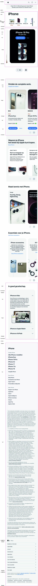
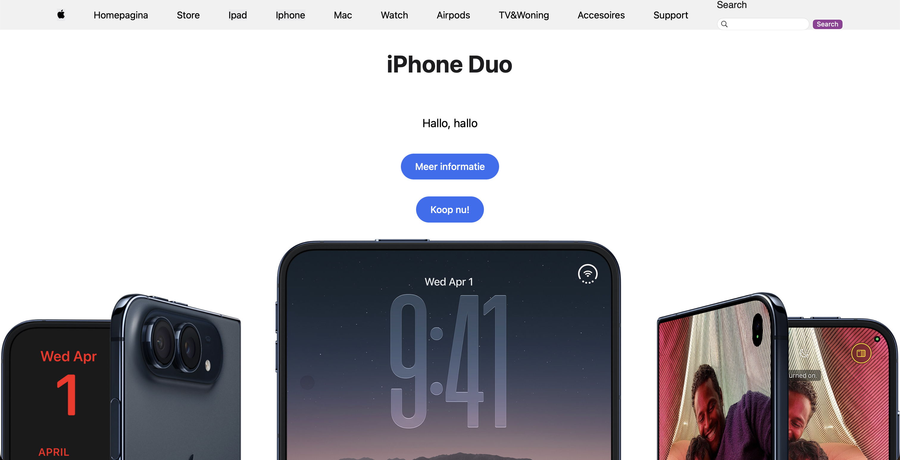
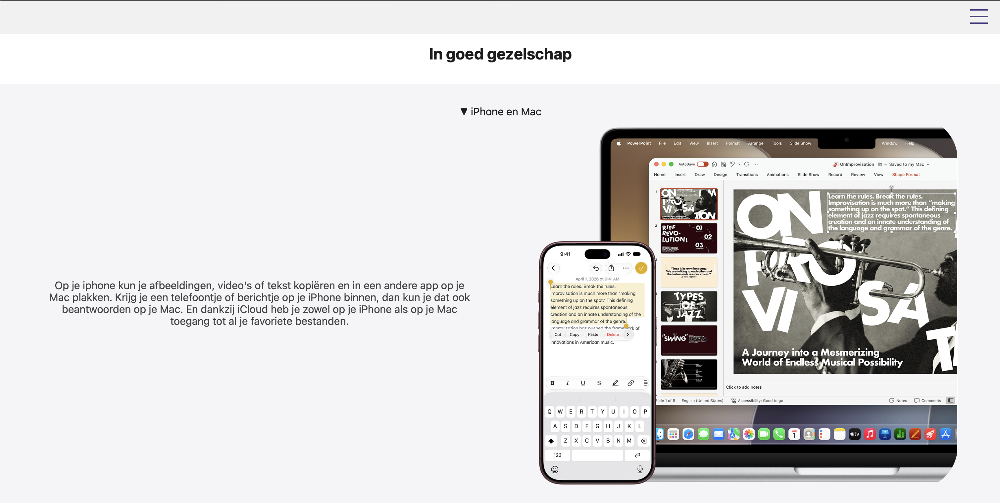
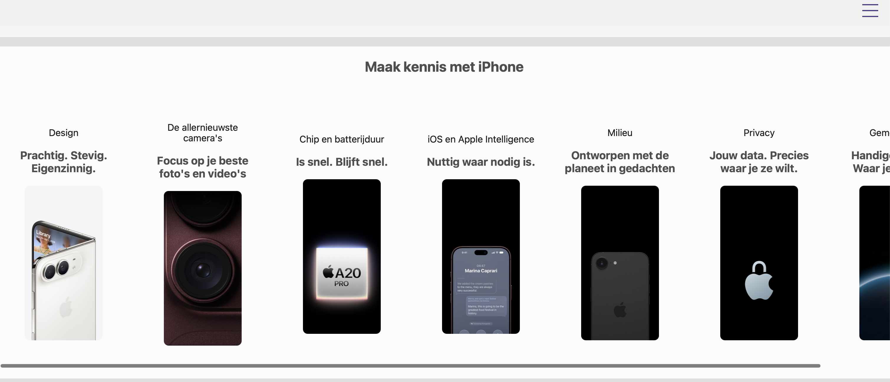
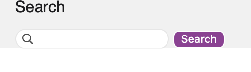
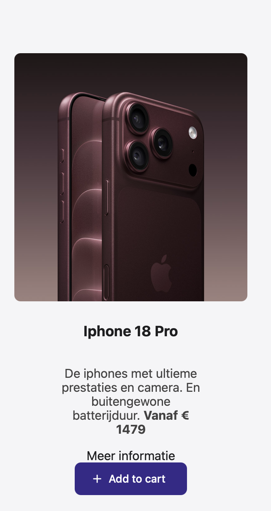

# Procesverslag
Markdown is een simpele manier om HTML te schrijven.  
Markdown cheat cheet: [Hulp bij het schrijven van Markdown](https://github.com/adam-p/markdown-here/wiki/Markdown-Cheatsheet).

Nb. De standaardstructuur en de spartaanse opmaak van de README.md zijn helemaal prima. Het gaat om de inhoud van je procesverslag. Besteedt de tijd voor pracht en praal aan je website.

Nb. Door *open* toe te voegen aan een *details* element kun je deze standaard open zetten. Fijn om dat steeds voor de relevante stuk(ken) te doen.

## Jij

  
uitwerken voor kick-off werkgroep

  ### Auteur:
  Cheyenne van der Spijt

  #### Je startniveau:
  Blauw

  #### Je focus:
  Surface Plane
 

## Je website

  
uitwerken voor kick-off werkgroep

  ### Je opdracht:
  https://www.apple.com/nl/ 

  #### Screenshot(s) van de eerste pagina (small screen): 
Apple Homepage

  #### Screenshot(s) van de tweede pagina (small screen):

 

## Toegankelijkheidstest 1/2 (week 1)

  
uitwerken na test in 2e werkgroep

  ### Bevindingen
  Lijst met je bevindingen die in de test 1 naar voren kwamen:
  - Vanwege de vele animaties is het moeilijker de om de site door te komen vooral als je de voice over tool gebruikt.
  - Het is moeilijk om informatie te zoeken als je moeilijk kan typen of scrollen.
  - Light/dark mode is niet beschikbaar op de site zelf.
  - Je ziet de focus duidelijk, alleen met behulp van je eigen systeem instellingen.
  - Je kan de lettertypes niet groter of kleiner maken.

## Breakdownschets (week 1)

  
uitwerken na afloop 3e werkgroep

  ### de hele pagina: 
  

  ### dynamisch deel (bijv menu): 
  

  ### wellicht nog een dynamisch deel (bijv filter): 
  

## Voortgang 1 (week 2)

  
uitwerken voor 1e voortgang

  ### Stand van zaken
Ik was op dat moment nog bezig met breakdown sketch maar ik had wel het grootste gedeelte van mijn html af.

  ### Agenda voor meeting
Tijdens de meeting wil heb nog wat vragen over de website die ik na ga maken.
Ik twijfel namelijk of de 2e pagina die ik na wil maken wel een goede set is.
En ook wil ik weten hoe ik mijn breakdown sketch verder af moet maken.

  ### Verslag van meeting
Tijdens de meeting heb ik samen met mijn groep al onze vragen kunnen stellen. 
Lisa wilde weten hoe ze icons kon gebruiken zonder classes?
"De dingen die in de navbar moeten staan komen in een header te staan, alleen moeten ze in 2 of 3 aparte list items?
"En welke elementen kan je dan het beste gebruiken om hem te selecteren inplaats van classes te gebruiken.
"Bij welke foto's kan je het beste rem of pixels gebruiken om hem responsive te laten worden?"

Jegor:
"Hoe kan ik foto's van de website downloaden zodat die niet stretched zijn"
"Hoe moet ik de grid maken zodat alle foto's kloppen?"

## Voortgang 2 (week 3)

  
uitwerken voor 2e voortgang

  ### Stand van zaken
Ik heb nu mijn breakdown sketch soort van af moet allen de foot's nog in de readme plaatsen. 
Ik heb mijn html af en ik zit nu in de knoop met css er gaat nogal veel verkeerd.

  ### Agenda voor meeting
Graag wil ik de volgende vragen stellen aan mijn docent over het volgende:
"Hoe zorg ik dat mijn hamburger menu op de voorgrond blijft?"
-"Door de z-index aan te passen, als je deze zet op 9999 blijgt het op de voorgrond"
"Hoe zet ik mijn list items naast elkaar ipv 2 naast elkaar dat is niet gegaan zoals ik wilde"
-"In je Css heb je bepaalde aansprekings punten dubbel aangesproken waardoor er maar 1 werkt. Dus als je dat aanpast werkt het wel naar behoren"
"Hoe maak ik de links vormgeving kleiner want buiten de section worden ze wel kleiner maar in de section niet?"
-"Doordat je de sections verkeerd aanspreekt in de ul worden de onderdelen niet aangesproken"

  ### Verslag van meeting
Tijdens de meeting heb ik antwoord op de vragen kunnen krijgen. Ik heb met mijn docent de vragen doorgelopen en heeft hij mijn vragen kunnen beantwoorden. En daarbij heb ik ook live de oplossingen ervoor kunnen zien. Ook heb ik aantekeningen gemaakt en het opgeschreven zodat ik het niet vergeet hoe ik de code terug kan vinden.

## Toegankelijkheidstest 2/2 (week 4)

  
uitwerken na test in 9e werkgroep

  ### Bevindingen
  - De site beschikt over een skip-link.
  - Er zijn subtiele animaties aanwezig die niet te opvallend zijn voor de gebruiker.
  - De site is te gebruiken met het toetsen bord ook met de voice-over tool.
  - De html is volledig semantisch.
  - De tekst die bij de afbeeldingen horen zijn duidelijke woorden die de afbeelding omschrijven.
  - Het contrast is goed zichtbaar, de keluren zijn goed van elkaar te onderscheiden.
  - Ook heeft de site een duidelijke focus als je op onderdelen staat.
  

## Voortgang 3 (week 4)

  
uitwerken voor 3e voortgang

  ### Stand van zaken
Ik heb de css van mijn site verder gebouwd en ik ben ook ondertussen gaan nadenken over welke surplane onderdelen ik erin wil.
Maar ik had nogal moeite met het organiseren van mijn sections en ik wil daarin graag een oplossing aangezien de pagina's wel verschillende van elkaar zijn en niet op elkaar lijken.

  ### Agenda voor meeting
Online gesprek op 21 oktober

  ### Verslag van meeting
Ik had gelukkig nog apart met Danny kunnen helepen en daarbij hielp hij mij met de sections opnieuw te organiseren.
Ook kreeg ik van hem de tip dat ik beter met 2 aparte css pagina's voor mijn 2 pagina's ging werken. 
Die tips heb ik opgeschreven en ik ben ik meteen mee aan de slag gegaan.
Zo heb ik ook geleerd hoe je werkt met grid-colums zodat ze verschillende formaten krijgen.
section:nth-child(-n+3) {
    grid-column: 1 / -1;
}
Ook heb ik nu helder welke onderdelen van de surplane ik wil verwerken in mijn pagina.
- Animaties (loading, nadruk, feedback, branding...)
- SVG (icons) stylen en animeren
- Werkend filteren/sorteren/zoeken
- Meer complete micro-interacties
- Video/geluid

## Eindgesprek (week 5)

  
uitwerken voor eindgesprek

  ### Je uitkomst - karakteristiek screenshots:

Over de homepage ben ik opzich wel te vreden omdat de layout best veel op de apple site lijkt. En dat is dan een professionele uitstraling waarvan ik graag wilde laten zien dat ik dat kon.

Over de 2e pagina ben ik vooral te vrede over de summary omdat die mij het moeilijkst leek om na te doen van de apple site en toch vind ik dat deze nog best goed gelukt is.

  ### Dit ging goed/Heb ik geleerd: 
Door met de apple site te knoeien heb ik meer met de flex box leren werken en ben ik steeds meer te weten gekomen over de verschillende werkingen ervan. En zo heb ik ook geleerd hoe je beter de plaatsing kan doen op de site.
  ### Dit was lastig/Is niet gelukt:
 
Deze onderdelen vond ik moeilijk om na te doen omdat ik niet goed weet hoe je van de achtergrond onderdelen een achtergrond afbeelding moet maken. Waardoor de afbeelding los staat van de tekst wat ik wel lastig vond om te doen. Wat ik ook lastig vond was de shopping cart micro interactie die ik heb toegevoegd in het voorbeeld dat ik zag werkte deze goed en ook de zoekbalk die ik op de eerste pagina heb gemaakt werkt niet goed. Ik heb erna gekeken met chatgpt nog en die zei dat het alleen reageerd op de <li> onderdelen die ik heb gemaakt. Nadat ik dat geprobeerd had zag ik nog steeds geen reactie.

Wat ook niet goed gelukt is dat alleen mijn homepagina goed werkt op een telefoon scherm. 

## Bronnenlijst

  
continu bijhouden terwijl je werkt

<!-https://www.w3schools.com/graphics/svg_path.asp om zelf het pijltje te maken als svg figuur-->
Verder heb ik op w3schools ook gekeken hoe ik kan werken met flex box om de afbeelding en tekst naast elkaar te zetten.
<!https://developer.mozilla.org/en-US/docs/Learn_web_development/Core/CSS_layout/Flexbox?utm_source=chatgpt.com>
Loader code van https://cssloaders.github.io
Search code van MDN maar werkte niet dus heb met chat en deze prompt gevraagd hoe het wel kan werken. 
https://developer.mozilla.org/en-US/docs/Web/HTML/Reference/Elements/input/search
"<li><label for="site-search">Search</label>
				<input type="search" id="site-search" name="q" />
				<button>Search</button></li> label {
display: block;
font:
      1rem "Fira Sans",
      sans-serif;
}
  input,
  label {
margin: 0.4rem 0;
} searchTerms = mySearch.value; hoe zorg ik dat deze code echt werkt?"

